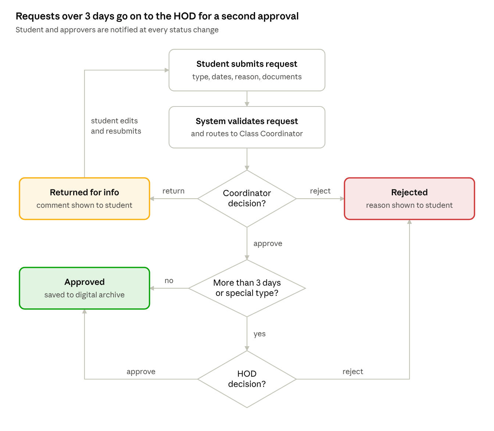

# 01 · Student Leave Management System – Business Requirements Document

## Scenario

A college wants to replace its paper-based student leave-request process with an online system. Students submit paper forms to class coordinators, cannot track request status, and staff spend time searching old forms.

## What was done

1. Identified **7 stakeholder groups** and their responsibilities, interest and influence (stakeholder register)
2. Wrote **8 functional** and **4 non-functional requirements** with MoSCoW priority
3. Defined **scope, out-of-scope items, assumptions and constraints**
4. Prepared a **stakeholder communication and requirement-gathering plan** (interviews, observation, survey, JAD workshop, prototype walkthrough)
5. Wrote **3 user stories** with Given / When / Then acceptance criteria

## Proposed approval flow

Leave over 3 days goes to the HOD for second-level approval; every status change notifies the student, and requests idle for 24 working hours are escalated.

## Key outcomes

| Objective | Target |
|-----------|--------|
| Requests submitted online | 100% within one semester |
| Average approval time | ≤ 24 working hours |
| Time to find a past leave record | Under 1 minute |
| Leave reporting | Monthly reports by student, class and department |

## Deliverable

[BRD_Student_Leave_Management_System.pdf](BRD_Student_Leave_Management_System.pdf) — BRD, stakeholder register, requirements, communication plan and user stories
