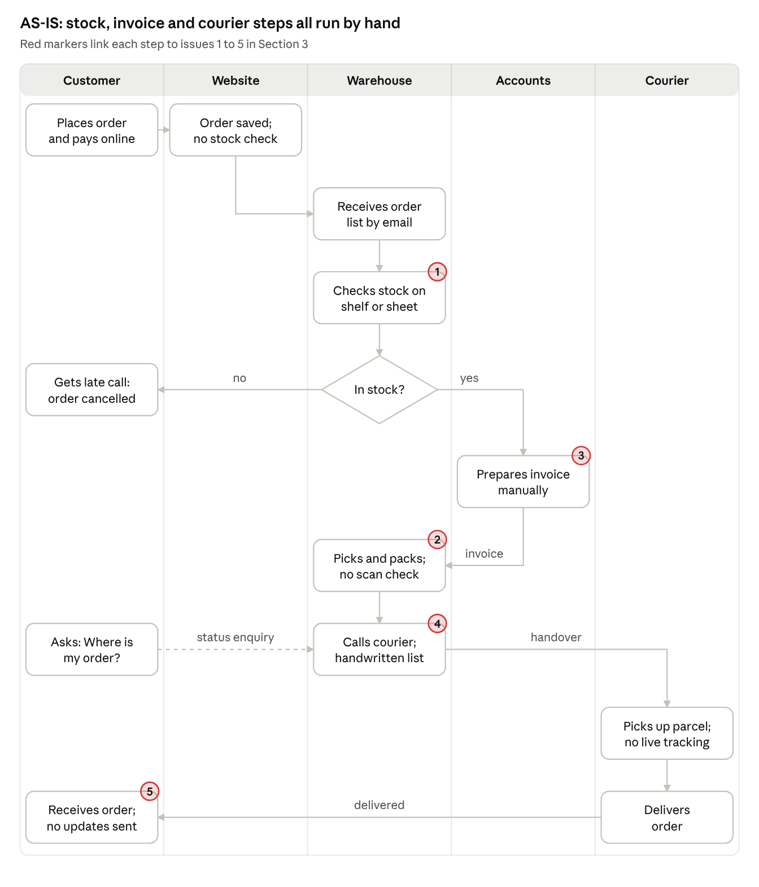
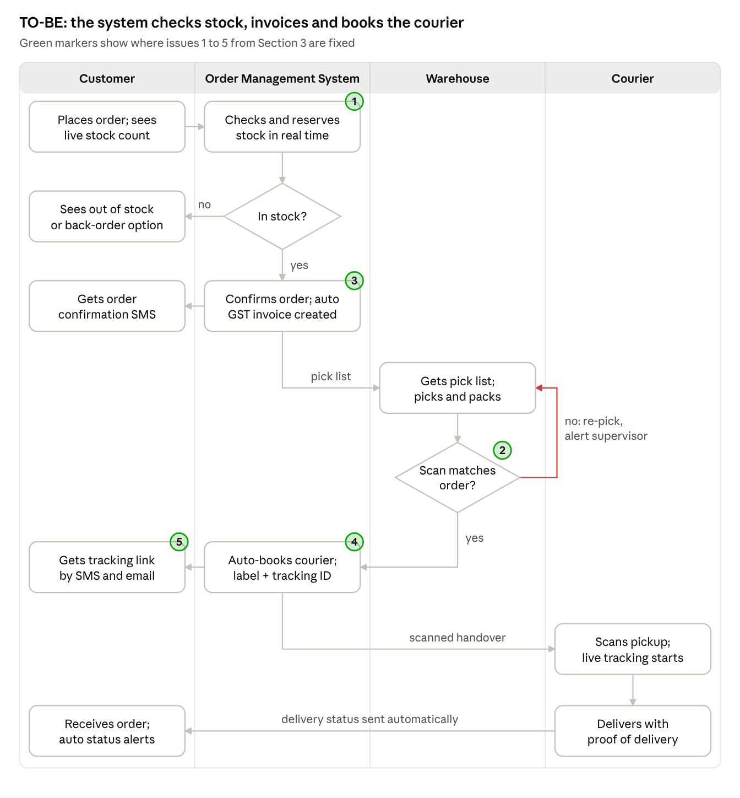

# 02 · Online Retail Order Fulfilment – AS-IS and TO-BE Process Analysis

## Scenario

An online retailer manually confirms stock, prepares invoices and hands orders to a courier. Customers receive delayed updates, and sometimes out-of-stock items are dispatched.

## AS-IS process

## Process issues and business impact

| # | Issue | Business impact |
|---|-------|-----------------|
| 1 | Stock confirmed manually after the order is accepted | Overselling, cancellations, refunds |
| 2 | No verification before dispatch | Wrong or out-of-stock items shipped; return and re-shipping costs |
| 3 | Invoices prepared manually | Dispatch bottleneck; price/GST errors |
| 4 | Manual courier handover | Missed pickups; no proof of handover |
| 5 | Delayed, manual customer updates | High "Where is my order?" contacts; low satisfaction |

## TO-BE process

An Order Management System linked to live inventory, automatic GST invoicing, barcode scan verification and the courier's API removes the manual hand-offs.

## KPIs

| KPI | Formula | Target |
|-----|---------|--------|
| Order-to-Dispatch Time | Σ(pickup scan time − order confirmed time) ÷ orders dispatched | ≤ 24 h for 95% of orders |
| Order Accuracy Rate | (orders delivered − wrong/missing-item complaints) ÷ orders delivered | ≥ 99.5% |
| Stock-out Cancellation Rate | orders cancelled "out of stock" ÷ total orders | ≤ 0.5% |
| WISMO Contact Rate | order-status enquiries ÷ total orders × 100 | 50% below baseline in 3 months |

## Process risks and controls

- **Inventory data mismatch** → scan every stock movement, safety-stock buffer, weekly cycle counts
- **Integration failure** (order system, invoicing, courier) → pre-release integration tests, stuck-order alerts, daily exception report

## Deliverable

[AS-IS_TO-BE_Process_Analysis_Order_Fulfilment.pdf](AS-IS_TO-BE_Process_Analysis_Order_Fulfilment.pdf)
