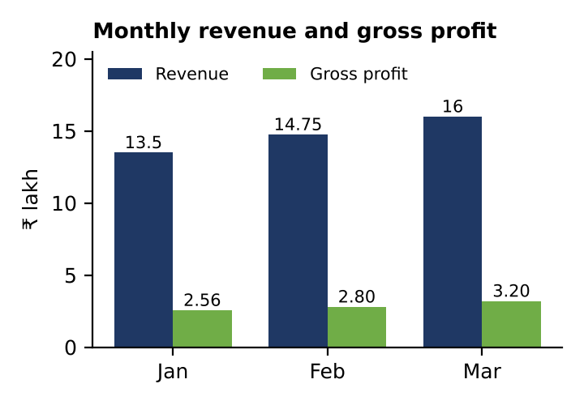
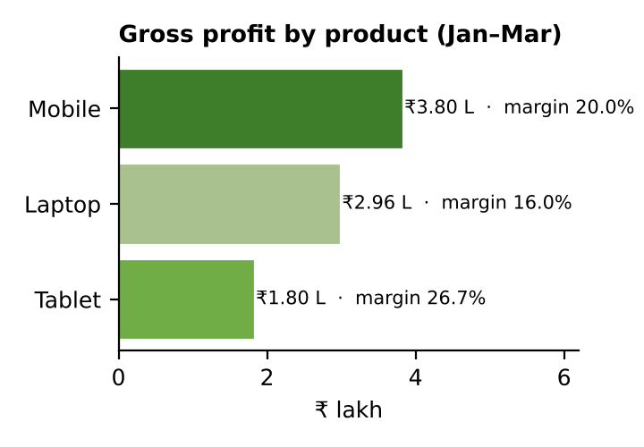

# 03 · Monthly Sales and Product Profitability Analysis

## Scenario

A retail manager wants to understand monthly sales and product profitability for three products (Laptop, Mobile, Tablet) over January–March. Amounts in INR.

## Approach

- **Revenue** = Units Sold × Unit Price
- **Gross Profit** = Units Sold × (Unit Price − Unit Cost)
- Monthly and product totals built with `SUMIFS`; top month and product found with `INDEX` / `MATCH` — the workbook recalculates if inputs change

## Results

| Measure | Value |
|---------|-------|
| Total revenue | ₹44,25,000 |
| Total gross profit | ₹8,56,000 (19.3% margin) |
| Highest-revenue month | **March** – ₹16,00,000 |
| Highest gross-profit product | **Mobile** – ₹3,80,000 (44% of total) |

## Insights

1. **Sales grew every month** — revenue +9.3% in February and +8.5% in March; margin improved from 19.0% to 20.0%.
2. **Mobiles drive profit** — 44% of gross profit; March growth came mainly from mobiles (25 → 40 units).
3. **Laptops slipping, tablets rising** — laptops have the lowest margin (16%) and fell 33% in March; tablets have the best margin (26.7%) and doubled in units.

## Recommendations

1. **Grow the tablet business** — more stock and visibility, mobile + tablet bundles.
2. **Recover laptop performance** — investigate the March drop; negotiate cost or add accessory bundles (each ₹1,000 cost cut = +2 pts margin).

## Deliverables

- [Sales_Profitability_Analysis.xlsx](Sales_Profitability_Analysis.xlsx) — data sheet with formulas, summary sheet, charts, insights
- [Insight_Summary_Sales_Profitability.pdf](Insight_Summary_Sales_Profitability.pdf) — one-page insight summary
